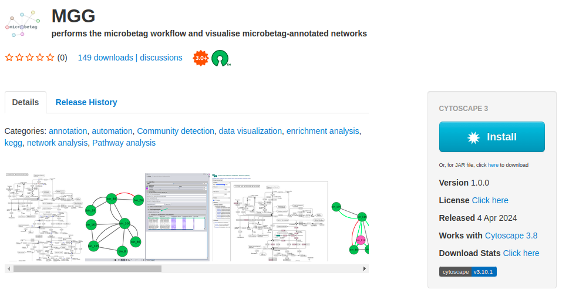
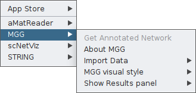

# Install `microbetag`

`microbetag` consists of several, independent tools, 
to allow users to get an annotated co-occurrence network based on their needs. 

Have a look at the [Usage modes](./modes.md) section regarding the different modules supported.

Here we provide instructions for installing the required components for each module across various computing environments.

<!-- Its basic features are the following: 

- *microbetag* Cytoscape App called MGG: no matter how you will actually run `microbetag`, 
  you will need `MGG` to visualize the annotated network. 
  Through MGG, you can upload your input data and directly call `microbetag` which will run on-the-fly on our server. 
  `microbetag` will first try to map the taxa present on the data to their corresponding GTDB genomes 
  based on their **taxonomies**. 
  This case is rather straight forward for the user, but it is limited in datasets with less than 1_000 taxa. 

- *microbetagDB* hosted at KU Leuven, it consists of all the pairwise GTDB reference genomes annotations. 
  You can directly access its contents using its corresponding [API](api).

- `microbetag_prep` a Docker image that allows you to run only two specific preprocessing steps: 
  - in case of 16S rRNA data, you can provide an abundance table with the ASV/OTU on its last column and your data will be taxonomically assigned using a GTDB-oriented 16S reference database.
  - for datasets with more than 1000 taxa, you can perform the network inference using this image and the `FlashWeave` tool. 
  After, you run this pre-process image, you may provide your findings on MGG instead of your original data. This way, you can run the streamiline on-the-fly version of `microbetag` for bigger datasets. 

- `microbetag` stand-alone tool. This is the most elevated way to access `microbetag`'s features. It is the one allowing you to move beyond the precalculations of the GTDB reference genomes and the `microbetagDB`, and instead, implement our approach on your own genomes, bins/MAGs, genome annotations or even Genome Scale Models. 
 -->

## Where to get what

  - `MGG` app: 
    - The app <a href="https://apps.cytoscape.org/apps/mgg" target="_blank">on your Cytoscape</a>
    - <a href="https://github.com/ermismd/MGG" target="_blank">Source code</a> for the app

  - preparation of amplicon data for the on-the-fly version: the prep workflow of `microbetag-nf` (below);
    previously, the stand-alone `microbetag_prep` tool
    (<a href="https://hub.docker.com/r/hariszaf/microbetag_prep" target="_blank">on DockerHub</a>,
    <a href="https://github.com/msysbio/microbetag/tree/preprocess" target="_blank">source code</a>)

  - `microbetag` stand alone: 
    - The tool <a href="https://hub.docker.com/r/hariszaf/microbetag" target="_blank">on DockerHub</a>
    - <a href="https://github.com/hariszaf/microbetag/" target="_blank">Source code</a>

  - `microbetag-nf` pipeline, running the external tools on your genomes:
    - <a href="https://github.com/msysbio/microbetag-nf" target="_blank">Source code</a>

  - `microbetagDB`: 
    - <a href="https://github.com/hariszaf/microbetag/tree/microbetagdb" target="_blank">Source code</a>
    - Key data products <a href="https://zenodo.org/records/10562677" target="_blank">on Zenodo</a>


## Install `MGG` Cytoscape 


  To start using *microbetag* and/or to visualize *microbetag*-annotated networks, you need first, to make sure you have **Cytoscape** on your system; if not, go ahead and [download Cytoscape](https://cytoscape.org/download.html). 

  Then, you need to install the *microbetag* app (`MGG`) from [Cytoscape App store](https://apps.cytoscape.org/apps/mgg).
  Make sure **you first launch Cytoscape** and then visit Cytoscape Appstore.
  If you have already visited the MGG page on Cytoscape Appstore, **launch Cytoscape and refresh the Cytoscape Appstore page**.
  You should now see the **Install** button.

  

  By clicking it, it will be automatically integrated on your Cytoscape. 
  If you visit Cytoscape Appstore and you have not lunched Cytoscape, you will see a *Download* button instead of the *Install*.
  As already mentioned, we suggest you lunch Cytoscape and refresh the page. 
  Otherwise, you can click the **Download** button and move manually the `.jar` file to the apps folder of your Cytoscape.

  You can also get `MGG` from within Cytoscape by clicking on the `Apps` tab of the main bar and then `App  Store > Show App Store` and typing `microbetag` on the box that pops up.

  Once the app is installed, you may click on the `Apps` tab, and you will find *MGG* there.

  


## Install stand-alone `microbetag`

  To annotate a network using your own genomes, there are two parts:

  - the [**microbetag-nf** pipeline](#the-microbetag-nf-pipeline) runs the external tools on your genomes
    (Prodigal, kofam, phenotrex, CarveMe/gapseq/ModelSEEDpy, FAPROTAX, FlashWeave, manta), and then `microbetag`;
  - the [**`microbetag` package**](#the-microbetag-package) computes the pathway and seed complementarities
    from the outputs of those tools and builds the annotated network.

  To start from your genomes, install the pipeline. If you already have the outputs of the tools
  (e.g. GEMs or KEGG annotations of your genomes), the package is enough.
  The tutorial [.. using custom genomes](./tutorials_local/local.md) describes both.


### The microbetag-nf pipeline

  You need [Nextflow](https://www.nextflow.io/); if not already available, follow the instructions
  <a href="https://www.nextflow.io/docs/latest/getstarted.html#installation" target="_blank">here</a>.

  You also need a containerization technology to run the tools:
  <a href="https://docs.docker.com/get-docker/" target="_blank">Docker</a>, or
  <a href="https://docs.sylabs.io/guides/3.0/user-guide/installation.html" target="_blank">Singularity</a> /
  <a href="https://apptainer.org/docs/admin/main/installation.html" target="_blank">Apptainer</a>.
  On an HPC system, Singularity or Apptainer is most likely already available, while Docker would not be an option.

  Then get the pipeline:

  ```bash
      git clone https://github.com/msysbio/microbetag-nf
  ```

  and follow its instructions [here](./tutorials_local/nf.md).
  Depending on the steps you run, the pipeline also needs:

  - the [KOfam database](https://www.genome.jp/ftp/db/kofam/), for the KEGG ORTHOLOGY annotation;
  - a [Gurobi license](#install-gurobi-license), for GEM reconstruction with CarveMe or gap-filling with DNNGIOR
    (or [CPLEX](#install-cplex), for gapseq).


### The `microbetag` package

  `microbetag` needs Python 3.10 or later. Install it from its source code:

  ```bash
      git clone https://github.com/hariszaf/microbetag.git
      cd microbetag/microbetag
      pip install .
  ```

  Add the `otf` extra (`pip install ".[otf]"`) for the on-the-fly version, which queries the microbetag database,
  and the `test` extra to run the tests (`pytest`, from the `microbetag/` folder of the repository).

  Check that it is available:

  ```bash
      microbetag --version
  ```


### .. as a container

  The `microbetag` package is also available as a Docker image, which also works with Singularity/Apptainer:

  ```bash
      docker pull hariszaf/microbetag:<version>
  ```

  If `<version>` is left out, Docker pulls the latest version.
  See the tutorial on [running `microbetag` on a container](./tutorials_local/containers.md).

  ```{note}
  `microbetag` needs a **configuration YAML file**; get the template of the version you are using with
  `microbetag --template config.yml`.
  See [the configuration file](./tutorials_local/config.md).
  ```


## Prepare amplicon data for the on-the-fly version

  For **amplicon** datasets that cannot be analyzed directly on-the-fly, you can run the computationally heavy tasks of

  - the network inference through FlashWeave, and
  - the taxonomy assignment against
    <a href="https://zenodo.org/records/6655692" target="_blank">a GTDB-specific 16S rRNA database</a>,
    which improves the matching of your taxa to the genomes of microbetagDB,

  locally, with the **prep workflow** of the [microbetag-nf pipeline](#the-microbetag-nf-pipeline).
  See [the preparation steps](./tutorials_otf/prep.md).

  ```{note}
  These steps used to be in a stand-alone image, `hariszaf/microbetag_prep` (up to v1.0.1).
  It is still on Docker Hub, but it is no longer developed.
  ```


## Further dependencies 

### Containerization technologies: Docker and Singularity/Apptainer


Most of `microbetag`'s modules are available as containers too. 

So far, we have tested them using:

* 🐳 [Docker](https://docs.docker.com/get-docker/) 

* ⚡[Singularity](https://docs.sylabs.io/guides/3.0/user-guide/installation.html): specified for HPC systems


### Install `gurobi` license

  GEM reconstruction with CarveMe, and gap-filling of ModelSEEDpy reconstructions with DNNGIOR, need a solver;
  CarveMe requires one to run (Gurobi or CPLEX). These steps run in the [microbetag-nf](./tutorials_local/nf.md)
  pipeline; `microbetag` itself does not need a solver.

  The reconstruction approaches:

  - **using `carveme`:** works on both DNA and protein sequences and uses the
    <a href="http://bigg.ucsd.edu" target="_blank">BiGG identifiers</a>.

  - **using `modelseedpy`:** requires a RAST annotation of your genomes, which depends on a connection to the RAST server.
    It uses the <a href="https://modelseed.org" target="_blank">ModelSEED resource</a> and its identifiers,
    but it can be rather time-consuming and quite often unsuccessful, due to RAST-related issues.

  In the following sections we provide some links on how to get a Gurobi license (for academics):

#### .. on a local system

  We found 
  <a href="https://www.youtube.com/watch?v=oW6ma8rdZk8" target="_blank">this video</a> 
  (released on 2022) quite helpful on how to get a Gurobi license. 

  Your license is a `gurobi.lic` file. To check that Python can use the license, in an environment with `gurobipy`:

  ```python
      >>> import gurobipy
      >>> m = gurobipy.Model()
      Set parameter Username
      Academic license - for non-commercial use only - expires 2025-04-15
  ```

#### .. on a container

  To use Gurobi in a container, you need a different kind of license, called
  <a href="https://www.gurobi.com/downloads/" target="_blank">**Web License Service (WLS)**</a>.
  You may find the following
  <a href="https://support.gurobi.com/hc/en-us/community/posts/4406485885841-Installing-Gurobi-on-a-Docker-container-Ubuntu" target="_blank">link</a>
  useful on how to get one.

  The WLS license is again a `gurobi.lic` file. The microbetag-nf pipeline describes how to give it to the
  CarveMe and DNNGIOR containers.


### Install CPLEX

[IBM ILOG CPLEX Optimization Studio](https://www.ibm.com/products/ilog-cplex-optimization-studio)

Jump to [IBM login](https://login.ibm.com/) page. 
If you do not have an account already, create one by clicking on the _Create an IBMid_


https://academic.ibm.com/a2mt/downloads/data_science#/


https://ronennir.medium.com/installing-cplex-optimization-studio-on-ubuntu-20-04-53e234ca4ec2


https://www.youtube.com/watch?v=o8plELhkazU


