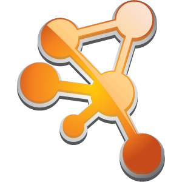

# Usage modes


## What microbetag is made of

You need two things:

*  **`MGG`, the Cytoscape app:**
  sends your data to a `microbetag` server and loads the annotated network back, and lets you browse it and run
  enrichment analyses within Cytoscape. Whatever way you annotate your network, you explore it with `MGG`.

*  **`microbetag`**, one repository
  with three parts:

  | Part | What it does |
  |---|---|
  | the **package** (`microbetag/`) | computes the pathway and seed complementarities from the outputs of the external tools and builds the annotated network (`.cx2`); a Python package and the `hariszaf/microbetag` image |
  | the **pipeline** (`pipeline/`, *microbetag-nf*) | a Nextflow pipeline that runs the external tools (Prodigal, kofam, phenotrex, CarveMe/gapseq/ModelSEEDpy, FAPROTAX, FlashWeave, manta) in containers, and then the package |
  | the **server** (`server/`) | the web server `MGG` talks to, with its database of pre-computed annotations; it runs the package on-the-fly, and the pipeline for FlashWeave, FAPROTAX and manta |

  Our public server's database has the annotations of the GTDB representative genomes. With the pipeline, you can
  build a database of your own genomes and serve it with your own server.

[*Installation*](./installation.md) has where to get each of them.


## Running `microbetag`..

There are two ways to annotate a network, depending on the genomes you want to annotate it with:

| | 🚀 [**MGG and a server**](#mgg-and-a-server) | 💻 [**the pipeline and the package**](#the-pipeline-and-the-package) |
|---|---|---|
| Genomes | the GTDB representative genomes (our server), or your own (your server) | your own genomes, bins or MAGs |
| You run | Cytoscape and `MGG` | Nextflow, on your computer or an HPC |
| Taxa matched to genomes | by taxonomy | by genome identifier, or by taxonomy |
| The external tools run | once for all the genomes, in advance | on your genomes |


### MGG and a server

You load your abundance table, and optionally your network, in Cytoscape, and `MGG` sends them to a `microbetag`
server, by default ours. The server:

- matches the taxa of your data to their closest genomes in its database, by their taxonomy;
- infers the network with FlashWeave if you do not provide one, and runs FAPROTAX and manta (with the pipeline);
- annotates the network with the pre-computed traits and complementarities of the matched genomes,

and `MGG` loads the annotated network in Cytoscape.

```{note}
If your abundance table contains more than 1000 taxa, providing a corresponding network is required,
as well as a GTDB or Silva taxonomy.
```

For large 16S rRNA amplicon datasets, the [**prep** workflow](./tutorials_otf/prep.md) of the pipeline assigns
GTDB taxonomies to your sequences and infers the network on your computer, before you send them to the server.

To annotate networks with **your own genomes** in this way, build their database with the pipeline and run
[**your own server**](./tutorials_local/server.md).


### The pipeline and the package

The [**pipeline**](./tutorials_local/nf.md) runs the external tools on your genomes and then the package:

1. **`precalc`**: once for your genomes, all the annotations and pairwise complementarities;
2. **`annotate`**: as many times as you like, annotates a network from an abundance table (inferring the network
   with FlashWeave if needed), with the pre-calculations of `precalc`.

You get an annotated network (`.cx2`) to [load in Cytoscape](./tutorials_core/load.md) and browse with `MGG`,
as in the on-the-fly version.

Optionally, the pre-calculations become **your own database**: export them with `microbetag-export-db` and serve
them with [your own server](./tutorials_local/server.md), so that you, or your colleagues, annotate networks
through `MGG` with your genomes.

If you already have the outputs of the tools, for example GEMs or KEGG annotations of your genomes,
[the package](./tutorials_local/local.md) runs on them directly.

❗ The external tools can take several hours depending on the number of genomes;
this is why they run in advance, once per genome, and not for each network.


## How to

We provide tutorials to help you get started with `microbetag`, whether you're using the on-the-fly web-enabled version or running it locally with custom genome sets.

### 📌 Core Topics (Common to All Modes)

These tutorials introduce key concepts that apply to all usage modes of `microbetag`:

- Required [input files](./tutorials_core/input.md) and expected formats
- [Mandatory parameters](./tutorials_core/basic_params.md) that you may provide either through the `MGG` parameters panel
  on the on-the-fly version, or as part of your configuration YAML file for the local case.
- Features in the `MGG` Cytoscape app for [browsing annotated networks](./tutorials_core/roaming.md)
- Performing [enrichment analysis](./tutorials_core/enrichment.md) on network features


### MGG and a server

These tutorials guide you through using `microbetag` directly via Cytoscape and the MGG app, including:

- Firing `microbetag` [with](./tutorials_otf/from_net.md) or [without](./tutorials_otf/abd_only.md) a network file as input
- [Providing metadata](./tutorials_otf/abd_and_metadata.md) for the network inference
- Using the [prep workflow](./tutorials_otf/prep.md) for 16S rRNA data (to enable use of large datasets in on-the-fly mode)
- Running [your own server](./tutorials_local/server.md), with the GTDB genomes or your own

### The pipeline and the package

These tutorials demonstrate how to run `microbetag` on your own system:

- [The pipeline](./tutorials_local/nf.md): from your genomes to an annotated network, and to your own database
- [Running the package](./tutorials_local/local.md) on the outputs of the tools you already have, and
  [filling in its YAML configuration file](./tutorials_local/config.md)


### 🧑‍💻 Access programmatically and/or contribute

For coding-familiar users, we also provide instructions about:

- how to use `microbetag`'s [API](./api.md) to get either species specific annotations or 
  potential complementarities for species pairs from the database of our server

- the [code base of `microbetag`](./autoapi/index)


